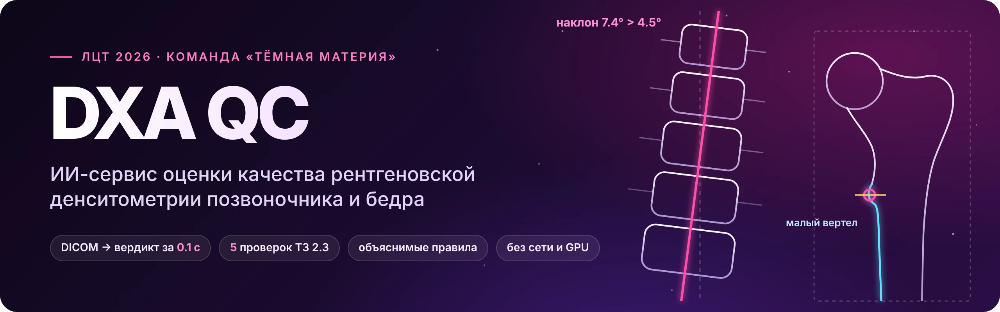
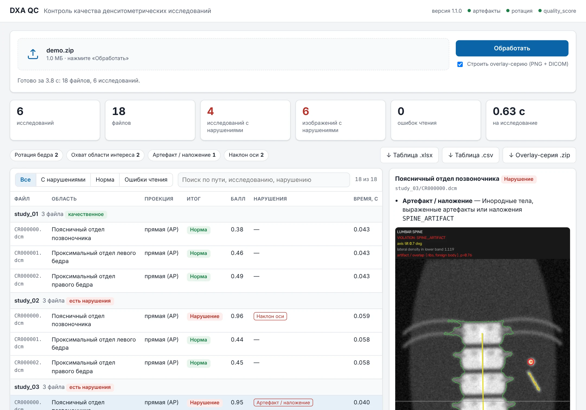
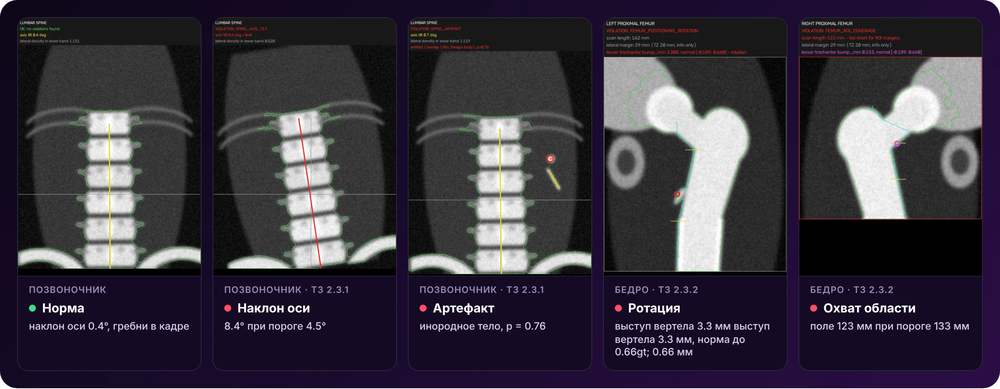
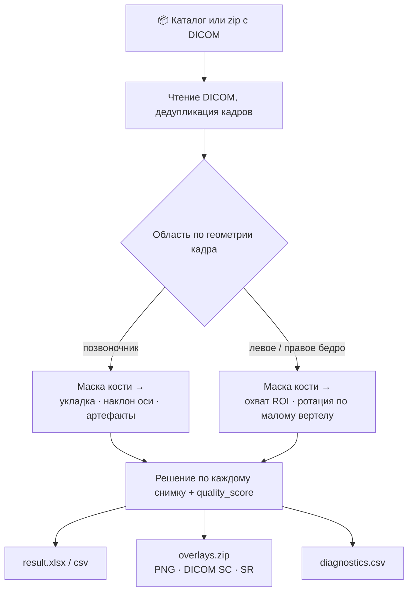

<a id="readme-top"></a>

<div align="center">



<br><br>

[](https://github.com/Fedosik-Nikonets/dxa-qc/tree/v1.1.0)
[](requirements.txt)
[](docs/deployment.md)
[](docs/api.md)
[](docs/output_format.md)
[](tests/)
[](#системные-требования-тз-31)

**[Возможности](#возможности)** ·
**[Демо](#демо)** ·
**[Как работает](#как-работает)** ·
**[Быстрый старт](#быстрый-старт)** ·
**[Качество](#качество)** ·
**[Соответствие ТЗ](#соответствие-тз)** ·
**[Документация](#документация)** ·
**[Команда](#команда)**

</div>

<br>

Сервис принимает рентгеновское денситометрическое исследование (DXA) в
формате DICOM и оценивает качество его выполнения по критериям ТЗ раздела 2.3:
определяет анатомическую область, проверяет её правилами качества и выдаёт
таблицу, в которой для каждого файла указан класс качества и, при нарушении,
его тип.

Ключевое свойство решения: **все правила детерминированы и объяснимы**. Каждое
решение — измерение против порога, и overlay-серия рисует это измерение прямо
на снимке. Ни torch, ни scikit-learn на инференсе не нужны, все веса модели
занимают 4.8 КБ.

<div align="center">

| **0.60 / 0.74** | **0.78** | **≈ 0.1 с** | **0 из 252** | **0 из 77** |
|:---:|:---:|:---:|:---:|:---:|
| F1 по снимкам / исследованиям,<br>честная проверка на 5 фолдах | ROC-AUC балла<br>`quality_score` | на исследование,<br>CPU, без GPU | ошибок определения<br>анатомической области | падений<br>на стресс-корпусе |

</div>

> [!NOTE]
> **Публичная копия.** Снимок тега `v1.1.0` рабочего репозитория одним
> коммитом, без истории. Код, веса, таблицы, отчёты и документация — как в
> теге; образ `dxa-qc_1.1.0.tar.gz` собран из этих же `src/`, `models/`,
> `docker/`. Убрано то, что принадлежит организатору или показывает снимки
> обучающего набора: `Data/` (исследования и разметка), `Task/` (ТЗ),
> PNG-листы с фрагментами снимков в `reports/`, картинки слайдов,
> инструменты разметки `annotations/*.html`, `*.pdf` и `.pptx` презентации.
> Поэтому **все снимки в этом README — синтетические фантомы**, прогнанные
> через настоящий сервис ([как они сделаны](docs/assets/README.md)).

## Возможности

- 🦴 **Автоопределение области** — поясничный отдел позвоночника, левое и правое бедро по геометрии кадра, без разметки: 0 расхождений с эталоном на 252 кадрах.
- 🔍 **Пять проверок ТЗ 2.3** — укладка, наклон оси и артефакты позвоночника; ротация и охват области интереса бедра. Несколько нарушений на снимке — перечнем.
- 🧭 **Каждое решение видно** — overlay-серия рисует ровно то измерение, по которому принято решение, а `diagnostics.csv` даёт его числа против порогов.
- 🩻 **DICOM на выходе** — overlay как DICOM Secondary Capture в том же исследовании и отчёт DICOM SR на исследование: можно загрузить в PACS рядом с оригиналом.
- 📈 **Балл для ROC-AUC** — `quality_score` в [0, 1]; больше 0.5 тогда и только тогда, когда есть нарушение.
- ⚡ **Быстро на любом железе** — около 0.1 с на исследование, с overlay-серией 0.3 с; GPU не нужен.
- 🔒 **Локально и без сети** — Docker-образ работает с `--network none`, веб-страница без внешних ресурсов, процесс в контейнере — не root.
- 🧪 **Устойчиво и воспроизводимо** — битые, сжатые, цветные и не-DICOM файлы дают строку `Failure` с причиной, а не падение; два прогона совпадают побайтово.

## Демо

<picture>
  <source media="(prefers-color-scheme: dark)" srcset="docs/assets/ui_dark.webp">
  
</picture>

<sub>Веб-интерфейс (`./run.sh --serve` → `http://localhost:8000/`) на шести синтетических исследованиях: сводка, фильтры по типам нарушений, таблица по исследованиям и overlay выбранного снимка. Снято на облачной машине без Docker, поэтому время на исследование здесь выше, чем в замерах ниже.</sub>

<br>



<sub>Overlay-серия: контур маски кости и измерения, по которым принято решение. Красным — сработавшее правило, жёлтым и голубым — измерение без нарушения, в шапке — итог и числа против порогов.</sub>

## Как работает



| Проверка (ТЗ) | Измерение | Нарушение, если | Код |
|---|---|---|---|
| **Позвоночник** · укладка (2.3.1) | плотность сбоку от позвоночника внизу кадра — гребни подвздошных костей | < 0.04 | `SPINE_POSITIONING` |
| **Позвоночник** · наклон оси (2.3.1) | угол главной оси маски к вертикали | > 4.5° | `SPINE_AXIS_TILT` |
| **Позвоночник** · артефакты (2.3.1) | top-hat вне позвоночника → логистическая регрессия | p ≥ 0.516 | `SPINE_ARTIFACT` |
| **Бедро** · охват ROI (2.3.2) | длина поля сканирования | < 133 мм | `FEMUR_ROI_COVERAGE` |
| **Бедро** · ротация (2.3.2) | выступ медиального края у малого вертела, `bump_mm` | вне [−0.19; 0.66] мм | `FEMUR_POSITIONING_ROTATION` |

Пороги подобраны на размеченном наборе организатора, качество каждого
проверено на отложенных фолдах; почему некоторые из них отличаются от буквы ТЗ (4.5° вместо 5°,
133 мм вместо 150 мм) — в [ограничениях](#ограничения).

**Почему правила, а не нейросеть.** На метку приходится от 6 до 36 позитивов.
На тех же фолдах обучаемые варианты правилам не выигрывают: классификатор по
пикселям — F1 0.48, гибрид — 0.51, голова на геометрии — 0.56, сервис — 0.60.
ResNet18 на области вертела дал 0.63, но разность с сервисом +0.03
[−0.04; +0.10] — в пределах шума, а в образ пришлось бы добавить torch.
Подробно — [docs/metrics.md](docs/metrics.md), модули и конвейер —
[docs/architecture.md](docs/architecture.md).

## Быстрый старт

Нужен только Docker (Linux или macOS). Решение работает без сети: правила и
веса лежат в образе, пакетный прогон запускается с `--network none` (ТЗ 3.2).

```bash
git clone https://github.com/Fedosik-Nikonets/dxa-qc.git && cd dxa-qc

./build.sh                          # образ dxa-qc:1.1.0 + проверка без сети
./run.sh <вход: каталог или zip> <выход>
./run.sh --serve                    # http://localhost:8000/, API — /docs
```

В каталоге результатов:

| файл | что внутри |
|---|---|
| `result.xlsx` | таблица ТЗ 2.5 — строка на каждый файл, плюс балл `quality_score` |
| `overlays.zip` | дополнительная серия (DICOM Secondary Capture и PNG) и отчёт DICOM SR на исследование, ТЗ 2.6–2.7 |
| `diagnostics.csv` | служебные колонки: углы, отступы, пороги — для разбора каждого решения |

На вход годится и архив организатора как есть (`НД_для_обучения.zip`): имена
в cp866 читаются правильно, обёртка `Исследования/` снимается автоматически.

<details>
<summary><b>Образ для машины без интернета (x86_64)</b></summary>

<br>

```bash
PLATFORM=linux/amd64 ./build.sh --save   # → dxa-qc_1.1.0.tar.gz
docker load < dxa-qc_1.1.0.tar.gz        # на месте
```

Состав образа: `python:3.12.7-slim-bookworm`, закреплённый по sha256;
зависимости из `docker/requirements-runtime.txt` — все версии закреплены,
включая транзитивные, ставятся только из готовых колёс, `pip check` при
сборке. torch и прочие библиотеки обучения в образ не входят: на инференсе они
не нужны, и это проверяется при сборке. Подробно — [docs/deployment.md](docs/deployment.md).

</details>

<details>
<summary><b>Запуск без Docker</b></summary>

<br>

```bash
python -m venv .venv && . .venv/bin/activate
pip install -r requirements.txt
pip install -e . --no-deps

python -m dxa_qc.batch --input <каталог или zip> --output result.xlsx \
    --diagnostics diagnostics.csv --overlays overlays.zip
python -m dxa_qc.service --port 8000     # API и веб-интерфейс
```

Все ключи командной строки — [docs/api.md](docs/api.md#командная-строка-без-контейнера).

</details>

### Системные требования (ТЗ 3.1)

GPU не нужен и не используется. Весь обучающий набор (100 исследований,
499 файлов): без overlay — 7 с и 225 МБ пиковой памяти процесса, с
overlay-серией в PNG и DICOM — 30 с и 242 МБ (Linux-VM на MacBook Air M2).
Самое долгое исследование стресс-теста (кадр 2048×2048) — 0.6 с при лимите
ТЗ 2.7 в 3 минуты.

| | минимум | рекомендуется |
|---|---|---|
| процессор | 1 ядро x86_64 или arm64 | 2 ядра и больше |
| память | 1 ГБ | 2 ГБ |
| диск | образ + входные данные + ~0.3 МБ на снимок под overlay-серию | то же |
| GPU | не нужен | не нужен |
| ПО | Docker 20+ | Docker 24+ |

## HTTP API

`./run.sh --serve` поднимает сервис на `http://localhost:8000`; интерактивная
документация — `/docs`.

| метод | путь | вход | выход |
|---|---|---|---|
| `POST` | `/batch` | zip-архив с исследованиями (поле `file`); `format=xlsx\|csv`, `overlays=true\|false` | файл таблицы; с `overlays=true` — zip с таблицей и `overlays.zip` |
| `POST` | `/predict` | файлы одного исследования (поле `files`) | JSON: строки таблицы, `quality_class` и `quality_score` исследования |
| `GET` | `/health` | — | статус, версия, загруженные модели и их sha256 |
| `GET` | `/` | — | веб-интерфейс |

```bash
curl -F file=@НД_для_обучения.zip "http://localhost:8000/batch?overlays=true" -o result.zip
curl -F files=@CR000000.dcm -F files=@CR000001.dcm "http://localhost:8000/predict?study=S1"
```

Все параметры, эндпоинты веб-интерфейса и коды ошибок — [docs/api.md](docs/api.md).

## Выходные данные

Восемь колонок ТЗ 2.5 в требуемом порядке, после них — `quality_score`,
`study` и `projection`. Пример на синтетических исследованиях из демо (UID,
время и служебные колонки опущены):

| path_to_study · anatomical_region | quality_class | violation_type | quality_score |
|---|:---:|---|:---:|
| `study_01/CR000000.dcm`<br>Поясничный отдел позвоночника | 0 | | 0.38 |
| `study_02/CR000000.dcm`<br>Поясничный отдел позвоночника | 1 | `SPINE_AXIS_TILT` | 0.96 |
| `study_03/CR000002.dcm`<br>Проксимальный отдел правого бедра | 1 | `FEMUR_ROI_COVERAGE` | 0.93 |
| `study_04/CR000001.dcm`<br>Проксимальный отдел левого бедра | 1 | `FEMUR_POSITIONING_ROTATION` | 0.99 |
| `study_07/readme.dcm`<br>Не определена | | файл не является DICOM (нет префикса DICM и разбор не удался) | |

`processing_status` у первых четырёх строк — `Success`, у последней — `Failure`.

- **Строка на каждый файл**, включая дубликаты и не-DICOM: молча пропускать опаснее.
- **У `Failure` колонка `quality_class` пуста**, а не 0: ноль означал бы «снимок качественный» о файле, который не удалось прочитать. Причина — в `violation_type`.
- **Несколько нарушений** — через `;` в порядке [`taxonomy.yaml`](taxonomy.yaml), например `FEMUR_POSITIONING_ROTATION;FEMUR_ROI_COVERAGE`.

Полное описание таблицы, overlay-серии и отчёта DICOM SR — [docs/output_format.md](docs/output_format.md).

## Качество

Обучающий набор: 249 размеченных изображений, 100 исследований, пять фолдов
по исследованиям, ДИ 95% — стратифицированный бутстреп по исследованиям.
«Честно» — порог выбирается на четырёх фолдах и применяется к пятому: это
ожидание на новых данных.

| срез | позитивов | чувств. | специф. | F1 [ДИ 95%] | F1, честно |
|---|:---:|:---:|:---:|:---:|:---:|
| Позвоночник, `quality_class` | 32 | 0.75 | 0.821 | 0.71 [0.59; 0.81] | 0.68 |
| Бедро, `quality_class` | 41 | 0.61 | 0.844 | 0.60 [0.47; 0.72] | 0.53 |
| **Все изображения** | 73 | 0.67 | 0.835 | 0.65 [0.56; 0.74] | **0.60** |
| **По исследованиям** | 50 | 0.80 | 0.660 | 0.75 [0.66; 0.82] | **0.74** |

- **ROC-AUC по баллу `quality_score`** (ТЗ 8.4), вложенно: **0.78** [0.70; 0.85] по снимкам, 0.71 по исследованиям.
- **Против тривиального «всё — нарушение»**: F1 по изображениям выше на **+0.14** [+0.05; +0.24], ДИ не касается нуля.
- **Ключевая точка** — малый вертел на overlay бедра: медиана расстояния до точки врача 9.0 мм на 58 кадрах.

Метрики по каждому правилу, ROC-AUC, сравнение вариантов модели —
[docs/metrics.md](docs/metrics.md). Все цифры воспроизводятся скриптами из
[`scripts/`](scripts/README.md).

## Соответствие ТЗ

**31 требование: 25 выполнены полностью, 5 — частично, 1 не реализовано.**
«Частично» — с оговоркой, у каждой есть пункт в [«Ограничениях»](#ограничения).

<details>
<summary><b>Таблица соответствия по пунктам ТЗ</b></summary>

<br>

| ТЗ | требование | как реализовано | статус |
|---|---|---|---|
| 2.1 | поясничный отдел позвоночника и проксимальный отдел бедра, автоопределение области | роутер по геометрии кадра, без разметки: 0 расхождений с эталоном на 252 кадрах, левое и правое бедро различаются | да |
| 2.2 | определение анатомической области и проекции | колонки `anatomical_region` и `projection`: проекция — из ViewPosition, без тега — прямая по протоколу (в наборе тега нет) | да |
| 2.2 | класс «качественное / есть нарушение» | `quality_class` на каждый файл, в интерфейсе — и вердикт исследования | да |
| 2.2 | оценка укладки и позиционирования | укладка и ось позвоночника, ротация бедра | частично: Th12 и видимость большого вертела, шейки и седалищной кости не проверяются — проверено на данных, почему (п. 1, 14) |
| 2.2 | корректность разметки анатомических структур и областей измерения | охват области интереса бедра; контур кости, ось, поле сканирования, точка малого вертела — на overlay. Эталонных контуров в наборе нет, проверка косвенная | частично (п. 11) |
| 2.2 | один или несколько типов нарушения | `violation_type` — перечень через `;` в порядке taxonomy.yaml | да |
| 2.2 | структурированный отчёт | таблица ТЗ 2.5 (xlsx/csv) и `diagnostics.csv`: измерения против порогов для каждого решения | да |
| 2.3.1 | укладка: гребни подвздошных костей и половина Th12 | `SPINE_POSITIONING` по плотности сбоку в нижней трети кадра | частично: Th12 — два позитива, ни одна из семи мер их не отделяет (п. 1) |
| 2.3.1 | наклон оси до 5° | `SPINE_AXIS_TILT`, главная ось маски, порог 4.5° | да (п. 2, 3 — сколиоз) |
| 2.3.1 | посторонние предметы, артефакты, наложения | `SPINE_ARTIFACT`, признак top-hat вне позвоночника | да (п. 4) |
| 2.3.2 | позиционирование: большой вертел, шейка, седалищная кость | в разметке организатора — одна метка с ротацией, её закрывает правило ротации; по оценке врача отсутствие седалищной кости эксперт нарушением не считает (10 норм из 18) | частично (п. 14) |
| 2.3.2 | ротация по малому вертелу | `FEMUR_POSITIONING_ROTATION`, два хвоста по профилю медиального края | да, самое слабое правило (п. 8) |
| 2.3.2 | область интереса: 3 см сверху и снизу, 2 см сбоку | `FEMUR_ROI_COVERAGE` по длине поля сканирования, 133 мм; 2 см сбоку противоречит разметке (138 из 150 «нарушений», AUC 0.17) — отступ показан на overlay справочно | частично (п. 5–7) |
| 2.4 | DICOM без разметки, до трёх изображений в исследовании, без зависимости от ПДн | pydicom и встроенный ридер без зависимостей; больше трёх кадров — предупреждение; атрибуты пациента в решение не входят | да |
| 2.5 | xlsx или csv, строка на изображение, восемь колонок | восемь колонок в порядке ТЗ, после них `quality_score` (балл для ROC-AUC, ТЗ 8.4), `study` и `projection` | да |
| 2.6 | дополнительная серия с визуализацией нарушения | overlay: DICOM Secondary Capture в исследовании исходника и PNG | да |
| 2.6 | текстовое описание в DICOM SR | Basic Text SR на исследование в `overlays.zip`: заключение, нарушения словами ТЗ, измерения против порогов, балл, ссылки на снимки | да |
| 2.6 | автокоррекция разметки с подтверждением | нет: во входных DICOM разметки нет (ТЗ 2.4), исправлять нечего — см. «Что не реализовано» | нет |
| 2.6 | веб-интерфейс загрузки, просмотра и пакетной обработки | `GET /` | да |
| 2.7 | не более 3 минут на исследование | около 0.1 с в среднем, с overlay-серией — 0.3 с; самое долгое в стресс-тесте — 0.6 с | да |
| 2.7 | нет необработанных исключений, ошибки — в отчёте | любая ошибка файла — строка `Failure` с причиной; стресс-тест: битые, сжатые, цветные, не-DICOM, пустые файлы | да |
| 2.7 | воспроизводимость | таблица (кроме времени) и архив overlay побайтово одинаковы между прогонами | да |
| 2.7 | пакетная обработка архива: общая таблица и zip с сериями | CLI, `POST /batch`, веб-интерфейс; zip на входе, `overlays.zip` на выходе | да |
| 3.1 | минимальная и рекомендуемая конфигурация | [«Системные требования»](#системные-требования-тз-31) | да |
| 3.2 | контейнер, скрипты сборки и запуска для Linux/UNIX | `Dockerfile`, `build.sh`, `run.sh` | да |
| 3.2 | локально, без внешних сервисов и передачи изображений | прогон с `--network none`, веса в образе, страница без внешних ресурсов | да |
| 3.2 | API пакетной обработки | `POST /batch` | да |
| 3.2 | зафиксированы версии зависимостей и базового образа | `requirements.txt`, `docker/requirements-runtime.txt` (с транзитивными), базовый образ по sha256 | да |
| 5 | README: восемь пунктов | назначение и ограничения — введение и «Ограничения»; структура — «Структура репозитория», [docs/architecture.md](docs/architecture.md); требования и зависимости — «Системные требования»; сборка и запуск — «Быстрый старт»; API — «HTTP API»; форматы — «Быстрый старт», «Выходные данные», [docs/output_format.md](docs/output_format.md); модель и обработка — «Как работает»; ошибки — «Ограничения», «Выходные данные» | да |
| 5 | руководство пользователя, руководство по развёртыванию, процедура обучения | [`docs/user_guide.md`](docs/user_guide.md), [`docs/deployment.md`](docs/deployment.md), [`docs/training.md`](docs/training.md) | да |
| 4, 7.2 | презентация по девяти пунктам и демонстрационный сценарий | презентация — PDF по ссылке из формы сдачи (исходник — [`presentation/src/`](presentation/src/)), [`docs/demo_scenario.md`](docs/demo_scenario.md) | да |

</details>

## Ограничения

Раздел важнее метрик: он перечисляет, где решение расходится с буквальным
текстом ТЗ или с разметкой организатора, и почему. Каждый пункт с цифрами и
воспроизведением — в [docs/limitations.md](docs/limitations.md).

1. [Реализована половина критерия укладки позвоночника](docs/limitations.md#1-реализована-половина-критерия-укладки-позвоночника) — гребни подвздошных костей проверяются, половина тела Th12 нет: два позитива, ни одна мера их не отделяет.
2. [Порог наклона оси — 4.5°, а не буквальные 5°](docs/limitations.md#2-порог-наклона-оси--45-а-не-буквальные-5) — откалиброван по F1; честная оценка F1 — 0.35.
3. [Правило оси конфликтует с анатомией при сколиозе](docs/limitations.md#3-правило-оси-конфликтует-с-анатомией-при-сколиозе) — сколиоз разметка нарушением оси не считает; отдельный флаг `OUT_OF_SCOPE_FINDING` на класс не влияет.
4. [Детектор артефактов обучен на 17 позитивах](docs/limitations.md#4-детектор-артефактов-обучен-на-17-позитивах) — и чаще всего ловит наложение рёбер, как и разметка.
5. [Порог охвата области интереса — 133 мм, а не 150 мм](docs/limitations.md#5-порог-охвата-области-интереса--133-мм-а-не-150-мм) — так размечает организатор; честная оценка F1 — 0.50.
6. [Боковое правило 20 мм из ТЗ на этих данных опровергается](docs/limitations.md#6-боковое-правило-20-мм-из-тз-на-этих-данных-опровергается) — ROC-AUC 0.17, отступ показан на overlay справочно.
7. [Два позитива охвата из семи не ловятся](docs/limitations.md#7-два-позитива-охвата-из-семи-не-ловятся) — по длине скана неотличимы от нормы.
8. [Правило ротации бедра — самое слабое, и включено сознательно](docs/limitations.md#8-правило-ротации-бедра--самое-слабое-и-включено-сознательно) — F1 0.48 вложенно, но без него бедро хуже тривиальной базы.
9. [Масштаб изображения восстанавливается косвенно](docs/limitations.md#9-масштаб-изображения-восстанавливается-косвенно) — `PixelSpacing` нет ни в одном файле набора.
10. [Ключ исследования — имя каталога, а не тег](docs/limitations.md#10-ключ-исследования--имя-каталога-а-не-тег) — `StudyInstanceUID` с разметкой не пересекается.
11. [Разметка организатора — на уровне «исследование × область»](docs/limitations.md#11-разметка-организатора--на-уровне-исследование--область) — корректность разметки структур проверяется косвенно.
12. [Снимок не той области не отбраковывается](docs/limitations.md#12-снимок-не-той-области-не-отбраковывается) — роутер выбирает из трёх областей ТЗ.
13. [Вопросы организатору остались без ответа](docs/limitations.md#13-вопросы-организатору-остались-без-ответа) — принятые допущения расписаны.
14. [Видимость большого вертела, шейки и седалищной кости отдельно не проверяется](docs/limitations.md#14-видимость-большого-вертела-шейки-и-седалищной-кости-отдельно-не-проверяется) — проверено по оценке врача, выигрыш не больше двух кадров.

**Что не реализовано:** вторая половина критерия укладки (Th12, п. 1) и
автокоррекция разметки с подтверждением специалистом (ТЗ 2.6): во входных
DICOM разметки нет, исправлять и проверять исправление не на чем.

## Документация

| документ | для кого | что внутри |
|---|---|---|
| [Руководство пользователя](docs/user_guide.md) | лаборант, врач | веб-интерфейс, колонки таблицы, типы нарушений, как читать overlay |
| [Развёртывание](docs/deployment.md) | инженер | сборка, перенос без интернета, пакетный прогон, сервис, неполадки |
| [HTTP API и CLI](docs/api.md) | интегратор | эндпоинты, параметры, ошибки, веб-интерфейс, ключи командной строки |
| [Форматы результатов](docs/output_format.md) | интегратор | таблица ТЗ 2.5, overlay-серия, DICOM SC и SR |
| [Как устроено](docs/architecture.md) | разработчик | конвейер и модули `src/dxa_qc/` |
| [Обучение и дообучение](docs/training.md) | ML-инженер | что подбирается, полный цикл с нуля, пересчёт на новых данных |
| [Качество](docs/metrics.md) | жюри, ML-инженер | метрики по правилам, ROC-AUC, сравнение вариантов модели |
| [Ограничения](docs/limitations.md) | все | 14 пунктов с цифрами и воспроизведением |
| [Воспроизводимость](docs/reproducibility.md) | ML-инженер | фолды, детерминированная запись, стресс-тест, тесты |
| [Демо-сценарий](docs/demo_scenario.md) | показ | сценарий на 6–8 минут (ТЗ 7.2) |

Полная карта, включая отчёты дней спринта, — [docs/README.md](docs/README.md); история версий — [CHANGELOG.md](CHANGELOG.md).

## Структура репозитория

```text
dxa-qc/
├── src/dxa_qc/        пакет: DICOM, роутер, правила, overlay, отчёты, API, веб
├── models/            веса сервиса — три файла, 4.8 КБ
├── tests/             pytest на синтетических DICOM
├── scripts/           01–26: разведка, пороги, метрики, проверки перед сдачей
├── reports/           отчёты дней спринта и таблицы со всеми цифрами
├── annotations/       точки бедра от врача на 80 снимках
├── docs/              руководства, API, форматы, метрики, ограничения
├── presentation/src/  исходник презентации (ТЗ 4)
├── plan/              рабочий план спринта
├── docker/            entrypoint и runtime-зависимости образа
├── Dockerfile, build.sh, run.sh    контейнер (ТЗ 3.2)
├── taxonomy.yaml      типы нарушений и области: коды и формулировки ТЗ
└── requirements.txt   окружение разработки (версии закреплены)
```

У каждой папки свой README с описанием содержимого:
[`models/`](models/README.md) · [`scripts/`](scripts/README.md) ·
[`reports/`](reports/README.md) · [`tests/`](tests/README.md) ·
[`annotations/`](annotations/README.md) · [`docs/`](docs/README.md) ·
[`plan/`](plan/README.md).

## Воспроизводимость

- **Фолды зафиксированы** — [`reports/split.csv`](reports/split.csv), единица разбиения — исследование.
- **Версии закреплены жёстко** — `requirements.txt`, а в образе — вместе с транзитивными.
- **Выход детерминирован** — два прогона различаются только колонкой `time_of_processing`; образы под arm64 и amd64 дают одинаковые таблицы.
- **Стресс-тест** — 77 файлов (пустые, текстовые, обрезанные, цветные, сжатые, 2048×2048, кириллица в путях): ни одного падения, строка на каждый файл.
- **Тесты** — `python -m pytest tests -q` или `python run_tests.py` без pytest; обе ветви ридера, с pydicom и без, проверяются отдельно.

Подробно — [docs/reproducibility.md](docs/reproducibility.md).

## Команда

| | роль | GitHub |
|---|---|---|
| **Фёдор Никонец** | капитан, ML-разработка | [@Fedosik-Nikonets](https://github.com/Fedosik-Nikonets) |
| **Илья Рыжиков** | ML-разработка | |

Команда «Тёмная материя» — студенты РЭУ им. Г. В. Плеханова, учимся на
ML-инженеров. Задача — Центр диагностики и телемедицины, хакатон «Лидеры
цифровой трансформации» 2026.

<div align="center">
<br>
<sub>Сервис — помощник, а не врач: результат носит вспомогательный характер и не заменяет оценку специалиста.</sub>
<br><br>
<a href="#readme-top">↑ наверх</a>
</div>
