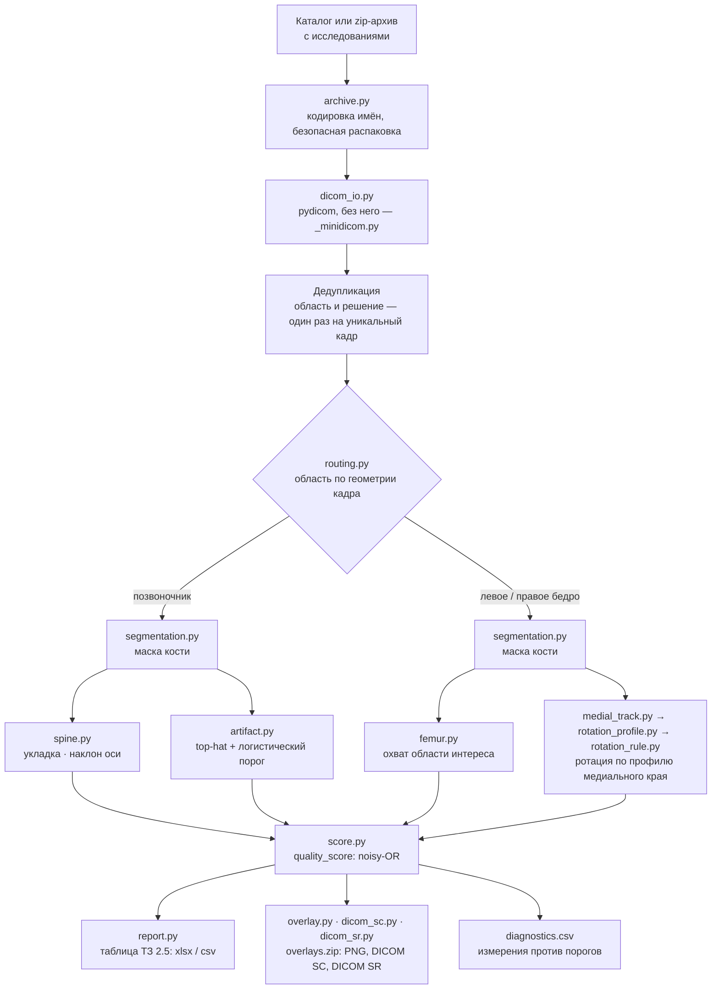

# Как устроено

[← README](../README.md) · [Карта документации](README.md)

Ключевое свойство решения: **все правила детерминированы и объяснимы**.
Три из пяти считаются из маски кости геометрией, артефакты — одним
физическим признаком с обученным порогом (веса 1650 байт), ротация бедра —
двумя порогами по профилю медиального края кости (границы в json на 1.2 КБ).
Ни torch, ни scikit-learn на инференсе не нужны. Каждый шаг можно показать
на слайде и защитить на разборе, а overlay-серия показывает его на каждом
снимке.

## Конвейер



CLI (`batch.py`), HTTP API (`service.py`) и веб-интерфейс (`webui.py`) — три
входа в один и тот же `batch.run`.

## Модули

```
src/dxa_qc/            пакет сервиса
  dicom_io.py          чтение DICOM: pydicom, а без него — встроенный ридер (_minidicom.py)
  segmentation.py      маска кости: трёхклассовый Otsu + ограниченный гистерезис
  routing.py           анатомическая область по геометрии кадра
  spine.py             правила позвоночника: наклон оси, укладка
  artifact.py          детектор артефактов: признак top-hat + логистический порог
  femur.py             правила бедра: охват области интереса
  medial_track.py      прослеживание медиального края бедра
  rotation_profile.py  признаки профиля края в окне малого вертела
  rotation_rule.py     правило ротации: два хвоста, границы из models/rotation_profile_v1.json
  overlay.py           overlay-серия и её детерминированный zip (запись потоком)
  dicom_sc.py          overlay как DICOM Secondary Capture, без pydicom
  report.py            таблица ТЗ 2.5 и её детерминированная запись
  batch.py             сквозной прогон каталога или архива
  archive.py           вход из zip: кодировка имён, безопасная распаковка, поиск каталога исследований
  service.py           HTTP API (FastAPI) поверх batch.run
  webui.py, web/       веб-интерфейс: задания и страница index.html без внешних ресурсов
  score.py             балл нарушения quality_score: noisy-OR вероятностей правил, >0.5 ⇔ нарушение
  dicom_sr.py          отчёт DICOM SR (Basic Text SR) на исследование, без pydicom
  metrics.py           метрики ТЗ 8.4 + стратифицированный бутстреп (для отчётов)
  rotation.py, trochanter.py   исследовательские измерения ротации, в конвейер не входят
models/                веса: artifact_tophat_v1.npz (1.6 КБ), rotation_profile_v1.json (1.2 КБ),
                       quality_score_v1.json (крутизна правил для балла)
Dockerfile, build.sh, run.sh, docker/   контейнер (ТЗ 3.2)
tests/                 pytest; tests/run_tests.py — запасной запускатель без pytest
scripts/               разведка, обучение, метрики, проверки (см. ниже)
reports/               отчёты дней спринта и таблицы, из которых взяты все цифры
annotations/           точки бедра, поставленные врачом (80 снимков)
docs/                  руководства пользователя, развёртывания, обучения; демо-сценарий
docs/presentation/     исходник презентации (ТЗ 4)
```

Скрипты `scripts/01`–`24` воспроизводят все цифры из отчётов в `reports/`
(порядок запуска — [`docs/training.md`](../docs/training.md)); каждый день спринта закрыт отчётом
`dayN_*.md`. [`scripts/freeze_check.sh`](../scripts/freeze_check.sh) и [`scripts/25_freeze_compare.py`](../scripts/25_freeze_compare.py) —
проверка перед сдачей: клон, тесты, сборка образа, прогоны через контейнер
без сети и сверка решений с эталоном.
