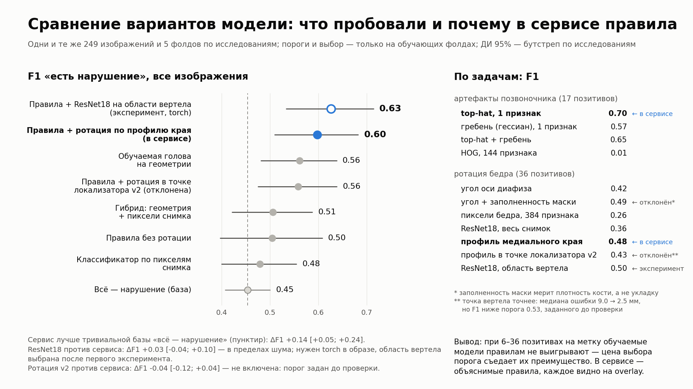

# Качество: метрики и сравнение вариантов модели

[← README](../README.md) · [Карта документации](README.md)

## Что оценивается и с каким качеством

Метрики на обучающем наборе, 249 размеченных изображений, 100 исследований,
объединение пяти фолдов [`reports/split.csv`](../reports/split.csv). ДИ 95% — стратифицированный
бутстреп по исследованиям. Детектор артефактов входит только out-of-fold.
Последняя колонка — F1, если порог геометрического правила подбирать
по F1 на четырёх фолдах и применять к пятому: это ожидание на новых данных,
а колонка F1 — качество порогов, выбранных на всех данных.

| область / правило | ТЗ | позитивов | чувств. | специф. | F1 [ДИ 95%] | ROC-AUC | F1, честно |
|---|---|---|---|---|---|---|---|
| Позвоночник: укладка | 2.3.1 рис.1 | 6 | 0.67 | 1.000 | 0.80 [0.50; 1.00] | 0.882 | 0.80 |
| Позвоночник: наклон оси | 2.3.1 рис.2 | 10 | 0.70 | 0.876 | 0.50 [0.31; 0.69] | 0.878 | **0.35** |
| Позвоночник: артефакты | 2.3.1 рис.3 | 17 | 0.71 | 0.939 | 0.71 [0.53; 0.86] | 0.840 | 0.71 |
| **Позвоночник, `quality_class`** | | 32 | **0.75** | 0.821 | **0.71** [0.59; 0.81] | | 0.68 |
| Бедро: охват области интереса | 2.3.2 рис.6 | 7 | 0.71 | 0.986 | 0.71 [0.36; 0.94] | 0.939 | **0.50** |
| Бедро: позиционирование/ротация | 2.3.2 рис.4–5 | 36 | 0.58 | 0.825 | 0.55 [0.40; 0.67] | | **0.48** |
| **Бедро, `quality_class`** | | 41 | **0.61** | 0.844 | **0.60** [0.47; 0.72] | | 0.53 |
| **Все изображения** | | 73 | 0.67 | 0.835 | 0.65 [0.56; 0.74] | | **0.60** |
| **По исследованиям** | | 50 | 0.80 | 0.660 | 0.75 [0.66; 0.82] | | 0.74 |
| По строкам таблицы (495, с дубликатами) | | 153 | 0.68 | 0.833 | 0.66 [0.56; 0.75] | | 0.60 |

Для ротации «честно» — вложенная проверка всей процедуры: выбор признака
из четырёх и подгонка двух границ внутри обучающих фолдов (F1 0.48
[0.34; 0.61], специфичность 0.75). Колонка F1 у ротации — границы,
подогнанные на всех 150 изображениях, как они стоят в конвейере.

macro-F1 по пяти типам нарушений — 0.65 (честно 0.57).

**ROC-AUC `quality_class` (ТЗ 8.4) по баллу `quality_score`**, вложенно:
крутизна подгоняется на четырёх фолдах, пороги правил — без проверочного
фолда (`python scripts/26_quality_score.py`, [`reports/quality_score/`](../reports/quality_score/)).

| срез | ROC-AUC по баллу | PR-AUC | ROC-AUC бинарного класса |
|---|---|---|---|
| все снимки (249) | **0.78** [0.70; 0.85] | 0.55 | 0.72 |
| позвоночник | 0.81 | | 0.77 |
| бедро | 0.74 | | 0.67 |
| по исследованиям (100) | 0.71 | 0.63 | 0.70 |

По бинарному классу ROC-AUC — это сбалансированная точность; балл даёт
ранжирование, не меняя ни одного решения.
F1 отдельного правила на одном фолде — шум: при 1–3 позитивах он прыгает
между 0 и 1, а в трёх парах «фолд × правило» позитивов нет вовсе. Разброс
по фолдам осмыслен только для агрегатов: `quality_class` по всем
изображениям 0.65 ± 0.07. Полный разбор — [`reports/day7_checkpoint.md`](../reports/day7_checkpoint.md) и
[`reports/day9_rotation_overlay.md`](../reports/day9_rotation_overlay.md), воспроизведение —
`python scripts/15_checkpoint_metrics.py`.

**С чем сравнивать.** При распространённости нарушений около 30% F1
тривиального ответа «всё — нарушение» не ноль: 0.45 по изображениям и
0.67 по исследованиям (нарушение есть в 50 исследованиях из 100). Честные
цифры решения — 0.60 и 0.74; парная разность с базой по изображениям —
**+0.14 [+0.05; +0.24]**, ДИ не касается нуля. До правила ротации бедро было ниже этой базы
(0.22 против 0.43), поэтому правило включено при F1 0.48 на своей метке —
обоснование в [`reports/day8_multilabel.md`](../reports/day8_multilabel.md).

**Обучаемая голова не принята.** Логистическая регрессия на метку поверх
геометрии и эмбеддинга изображения, со вложенным выбором регуляризации и
порога, не обыгрывает правила ни на одной метке, а по агрегату даёт
+0.00 [−0.13; +0.12] ([`scripts/16_multilabel_head.py`](../scripts/16_multilabel_head.py)). Все проверенные
варианты на одной мере — слайд ТЗ 4 [`reports/model_comparison/slide.png`](../reports/model_comparison/slide.png)
([`scripts/24_model_comparison.py`](../scripts/24_model_comparison.py)): классификатор по пикселям 0.48, гибрид
0.51, голова на геометрии 0.56, сервис 0.60, ResNet18-ротация из
экспериментальной ветки 0.63 (разность с сервисом +0.03 [−0.04; +0.10]),
ротация в точке точного локализатора вертела v2 0.56 (разность с сервисом
−0.04 [−0.12; +0.04], не включена — п. 8 «Ограничений»).

**Локализация ключевой точки (ТЗ 8.4, «расстояние между ключевыми
точками»).** Единственная ключевая точка, которую ставит сервис, — малый
вертел на overlay бедра. Расстояние от неё до точки врача на 58 кадрах,
где врач отметил вертел: медиана **9.0 мм**, p90 25.2 мм, в пределах 5 мм —
26%. Правило ротации меряет профиль края в окне вокруг этой точки, так что
промах точки — главная причина его ошибок (п. 8). Экспериментальный
локализатор v2 (OOF): медиана 2.5 мм, p90 18.8 мм, в пределах 5 мм — 84%;
в сервис не включён. Таблица — [`reports/model_comparison/localization.csv`](../reports/model_comparison/localization.csv).

Определение анатомической области работает без разметки, по геометрии
кадра: **0 расхождений с просмотренным глазами эталоном на 252 кадрах**
(99 позвоночников, 79 левых бёдер, 74 правых).

## Сравнение вариантов на одном слайде

Все проверенные варианты на одной мере и одной проверке (ТЗ 4,
[`scripts/24_model_comparison.py`](../scripts/24_model_comparison.py), данные — [`reports/model_comparison/`](../reports/model_comparison/)):

